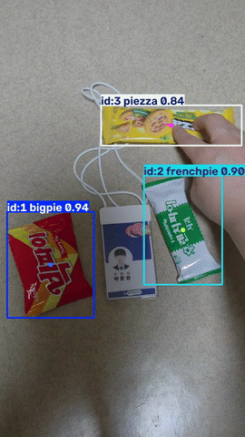

# YOLOv8 과자 감지·추적

빅파이(`bigpie`), 후렌치파이(`frenchpie`), 피자과자(`piezza`) 세 가지 과자를 YOLOv8로 학습하고 영상에서 감지·추적한 결과를 5초 영상으로 만들었습니다.



## 결과

- 결과 영상(5초): [outputs/result.mp4](outputs/result.mp4)
- 궤적: [outputs/trajectory.csv](outputs/trajectory.csv) (프레임마다 객체 중심 좌표), [outputs/trajectory.png](outputs/trajectory.png) (ID별 이동 경로)
- 학습 모델: [weights/best.pt](weights/best.pt) (YOLOv8n)
- 성능: [results/metrics.md](results/metrics.md), 학습 그래프는 [results/](results/)

| 데이터 | 박스 | Precision | Recall | mAP50 | mAP50-95 |
|---|---|---|---|---|---|
| test | 80 | 0.980 | 0.997 | 0.994 | 0.931 |
| val | 147 | 0.998 | 1.000 | 0.995 | 0.936 |

클래스별 test mAP50-95는 bigpie 0.962, frenchpie 0.895, piezza 0.936입니다.

결과 영상은 학습에 쓰지 않은 영상에서 손으로 과자 순서를 바꾸는 5초 구간입니다. 빅파이 #1과 후렌치파이 #2는 5초 내내, 피자과자 #3은 0.3~4.8초 동안 같은 ID로 추적됩니다.

## 구성

| 파일 | 하는 일 |
|---|---|
| `extract_frames.py` | 영상에서 학습용 사진 추출 (1초에 3장, 흐린 장면·중복 제외) |
| `prelabel.py` | 과자별 영상 사진에 박스 초안 생성 (YOLOE로 과자 봉지를 찾고 CLIP으로 종류 확인) |
| `modellabel.py` | 여러 과자가 함께 있는 사진에 박스 초안 생성 (먼저 학습한 모델 사용) |
| `make_dataset.py` | 검토한 라벨을 train / valid / test로 나누고 train에 90° 회전 사본 추가 |
| `train.py` | YOLOv8 학습 → `weights/best.pt`, `results/` |
| `track.py` | 감지 + 추적 → 결과 영상, GIF, 궤적 CSV·그림 → `outputs/` |
| `docs/labeling/` | 라벨 검토 기록 |

## 데이터

- 모두 직접 찍은 영상입니다 (폰 세로 1080×1920, 30fps).
  - 과자별 영상 6개: 과자마다 2개씩, 과자 하나를 여러 각도와 거리에서 찍었습니다.
  - 세 과자를 함께 놓고 손으로 옮기는 영상 1개
- 영상에서 1초에 3장씩 사진을 뽑아 박스 초안을 자동으로 만들고, 사진을 하나씩 보며 틀린 박스를 고치거나 뺐습니다.
- 같은 영상에서 이어 뽑은 사진은 서로 거의 같아서 영상마다 2초 구간 단위로 train / valid / test를 나눴습니다.
- 가로로 놓인 과자도 알아보도록 train 사진마다 90° 돌린 사본을 하나씩 더했습니다.
- 사진 수는 train 389장(+회전 사본 389장), valid 119장, test 66장입니다.

| 박스 수 | bigpie | frenchpie | piezza |
|---|---|---|---|
| train (회전 사본 제외) | 174 | 170 | 129 |
| valid | 52 | 56 | 39 |
| test | 25 | 30 | 25 |

원본 영상과 사진은 저장소에 올리지 않았습니다.

## 실행 방법 (맥, Apple Silicon)

```bash
python3 -m venv .venv && .venv/bin/pip install -r requirements.txt

# 1. 사진 뽑기
.venv/bin/python extract_frames.py --fps 3
.venv/bin/python extract_frames.py raw_videos/mix/mix_01.mp4 --fps 3 --out frames_mix --rejected frames_mix_rejected

# 2. 박스 초안 만들기
.venv/bin/python prelabel.py
.venv/bin/python modellabel.py frames_mix --model <과자별 사진으로 먼저 학습한 모델>

# 3. 데이터셋 나누기
.venv/bin/python make_dataset.py --rot90

# 4. 학습
.venv/bin/python train.py --data datasets/snacks/data.yaml

# 5. 추적 (5초)
.venv/bin/python track.py raw_videos/test/test_03.mp4 --start 2.5 --conf 0.4 --tracker botsort.yaml --buffer-sec 2
```

학습 설정은 YOLOv8n, imgsz 640, batch 16, 최대 100 epoch입니다. 75 epoch에서 조기 종료됐고 M2 Max GPU(`mps`)에서 26분 걸렸습니다.

## 추적과 궤적

- `model.track(persist=True)`가 프레임마다 감지한 박스를 추적기로 연결해 같은 과자에 같은 ID를 붙입니다.
- 추적기는 BoT-SORT를 썼습니다. 손에 가려 잠깐 사라진 과자는 2초까지 기억했다가 같은 ID로 다시 잇습니다(`--buffer-sec 2`).
- 공식 예제는 궤적을 화면에만 그립니다. 여기서는 프레임마다 객체 중심 좌표를 `trajectory.csv`에 따로 저장하고, ID별 전체 경로를 `trajectory.png`로 그립니다.
- `trajectory.csv`의 열은 `frame`, `time_s`(5초 클립 기준), `video_frame`, `video_time_s`(원본 영상 기준), `id`, `class`, `conf`, `cx`, `cy`, `x1`, `y1`, `x2`, `y2`입니다.

## 한계

- 손이 과자를 덮는 순간에는 박스가 손까지 크게 잡히거나 1~2프레임짜리 엉뚱한 박스가 생깁니다.
- 폰을 손에 들고 찍어서 궤적에 과자 움직임과 화면 움직임이 섞여 있습니다.
